# PocketClaw · Zectrix Note 4 小学生智能学习伴侣

**版本：1.0**

[](LICENSE)
[](https://idf.espressif.com/)
[](https://fastapi.tiangolo.com/)
[](https://zectrix.com)

> **Note 4 墨水屏全天候少儿伴学系统**  
> 一张会自己干活的墨水屏“今天清单”与全天候护眼伴学掌机。  
> 软硬件一体化：ESP32-S3 固件 + FastAPI AI 独立服务端 + 家长 Web 门户 + 微信原生小程序。

---

PocketClaw 可在本地或家庭局域网中独立运行。在线对话、拍照识别及语音服务需要分别配置相应服务；API 密钥保存在本机配置文件中。

---

## 目录

- [一、 产品定位与设计理念](#一-产品定位与设计理念)
- [二、 软硬件系统架构](#二-软硬件系统架构)
- [三、 19 大核心伴学功能详解](#三-19-大核心伴学功能详解)
- [四、 学伴人设与 AI / OCR 双模式引擎](#四-学伴人设与-ai--ocr-双模式引擎)
- [五、 硬件驱动与墨水屏视觉系统](#五-硬件驱动与墨水屏视觉系统)
- [六、 家长端与微信小程序](#六-家长端与微信小程序)
- [七、 Note 4 机身交互与语音指令速查](#七-note-4-机身交互与语音指令速查)
- [八、 快速启动与全链路部署指南](#八-快速启动与全链路部署指南)
- [九、 自动化测试与工程质量保障](#九-自动化测试与工程质量保障)
- [十、 开源协议与致谢](#十-开源协议与致谢)
- [十一、 开源教育资源引用与致谢](#十一-开源教育资源引用与致谢)

---

## 一、 产品定位与设计理念

小学生课后学习常常陷入两大困境：一是面对手机、平板等多功能设备极易分心沉迷，长时间面对液晶蓝光伤眼；二是纸质作业缺乏智能互动与及时反馈，背诵、听写、口算高度依赖家长在旁陪伴。

**PocketClaw** 基于 **ZECTRIX Note 4** 4.2 英寸电子墨水屏打造，旨在成为摆在孩子书桌前一张**“会自己干活的今天清单”**：

1. **“今天清单”专注哲学（Zero-Distraction Flow）**：
   - **开机即清单**：摒弃繁琐的多层级电子操作系统，开机直达今日待办清单，无游戏、无广告、无非学习弹窗推送；
   - **顺畅单向流转**：从上往下按 ●，作业、听写、背诵、口算、阅读逐项攻克，完成后自动画勾归档，建立充实的成就感。
2. **纸质书卷感与视力友好（16-Gray Paper Feel）**：
   - **零蓝光反射式显示**：全反射式电子墨水屏，光线越充足越清晰，宛如纸质课本，从根源保护儿童视力；
   - **教科书级印刷品质**：SSD2683 硬件 16 灰阶直驱，搭配**冬青黑体（Hiragino Sans GB W3）**，字形圆润柔和，彻底告别低精度字体带来的毛刺与生硬感。
3. **极简儿童盲操体系（3-Button Tactile Interaction）**：
   - **纯物理三键掌控**：机身仅设 `▲`（选行/上一项）、`▼`（下移/下一项/换令）、`●`（确认/完成/朗读/说话）三颗按键，6 岁儿童无需说明书即会使用；
   - **语音直达功能**：按住 ● 键说出“开始听写”“做口算”“背古诗”或“看课表”等指令，松开后即可进入对应功能页面，也可以直接向 AI 学伴提问。更多指令见[语音指令速查](#七-note-4-机身交互与语音指令速查)。
4. **“三端协同”自律闭环（Three-Way Synergy Loop）**：
   - **孩子端（Note 4 墨水屏）**：纯粹高效，专注自律；
   - **家长端（微信小程序 + Web 门户）**：远程下发作业清单、拍照一键录入课本生字单、推送名画屏保与番茄钟；
   - **AI 伴学云脑**：负责自然语言背诵质检、智能组词报词、动态生成口算题库与科学事实核验。

---

## 二、 软硬件系统架构

```text
┌────────────────────────────────────────────────────────────────────────┐
│                        微信小程序端 (家长移动端)                        │
│   · 拍照OCR录入生词/短文   · 远程番茄钟控制   · 16灰阶世界名画推屏     │
│   · 今日作业/习惯打卡管理  · 课程表配置       · 自律星星存折/心愿兑换   │
│   · 学伴人设自定义 (小龙虾)· LLM/OCR 本地与云端双模式切换              │
└───────────────────────────────────┬────────────────────────────────────┘
                                    │ HTTPS / REST API
┌───────────────────────────────────▼────────────────────────────────────┐
│                    FastAPI 伴学服务端 & 家长 Web 门户                   │
│   · WebSocket 双工状态机 (18大伴学引擎)      · 设备注册与在线心跳管理   │
│   · 大模型动态提问推理 / 少儿事实核查引擎   · 400×300 墨水屏图像排版   │
│   · 智能 OCR 视觉解析 (课本生词/双语短文)    · Leitner 遗忘曲线记忆算法 │
│   · 学伴 Prompt 动态装配与双模 LLM 引擎     · 开箱即用，零外部中台依赖 │
└───────────────────────────────────▲────────────────────────────────────┘
                                    │ WebSocket / Binary Protocol
┌───────────────────────────────────┴────────────────────────────────────┐
│                       ZECTRIX Note 4 (硬件固件端)                       │
│   · ESP32-S3 双核 240MHz + 8MB PSRAM + 16MB Flash                      │
│   · SSD2683 4.2" 400×300 墨水屏 (硬件 16 灰阶多阶段 LUT 直驱)         │
│   · 冬青黑体 W3 (Hiragino Sans GB) + Montserrat 中英文混排矢量渲染     │
│   · 本地花火/蜡烛物理动画番茄钟 (100px 抗锯齿超大数字)                 │
│   · ES8311 音频编解码 + 流式语音上行 + 纯物理 3 键盲操                 │
└────────────────────────────────────────────────────────────────────────┘
```

### 仓库工程目录结构

```text
Zectrix-claw/
├── zectrix/                   # 【硬件固件】Zectrix Note 4 ESP32-S3 固件工程
│   ├── main/                  # 固件主业务逻辑（按键路由、页面调度、音频服务）
│   │   ├── boards/            # SSD2683 16灰阶多波形直驱与按键/电源驱动
│   │   ├── components/        # 冬青黑体 Hiragino Sans GB 高清点阵字库与官方组件
│   │   ├── focus_digits.h     # 100px 冬青黑体番茄钟大字字模
│   │   ├── focus_page.cc      # 本地花火/蜡烛物理引线燃烧动画引擎
│   │   └── application.cc     # WebSocket 会话管理、按键路由与多功能调度
│   ├── CMakeLists.txt         # ESP-IDF 构建脚本
│   └── partitions/            # 16MB Flash 分区表配置
│
├── server/                    # 【独立后端】PocketClaw AI 学伴独立服务端 (自闭环、零外部依赖)
│   ├── app.py                 # FastAPI 应用入口（REST / WebSocket / 静态资源全集成）
│   ├── serve.py               # 独立服务启动脚本（开箱即用，自动解析局域网 IP）
│   ├── runtime.py             # 独立伴学运行时（自包含双模 LLM / 离线常识推理 / OCR 引擎）
│   ├── requirements.txt       # Python 依赖清单
│   ├── pytest.ini             # 自动化测试配置
│   ├── .env.example           # 大模型 API Key 配置模板
│   ├── pocketclaw/            # Note 4 核心业务包
│   │   ├── bridge.py          # WebSocket 双工会话编排（19 大伴学状态机调度）
│   │   ├── endpoint.py        # REST API 与家长 Web 控制台
│   │   ├── practice.py        # 口算、飞花令、拆拆看、事实核查算法引擎
│   │   ├── reading.py         # 英语分级短文阅读与口语评测引擎
│   │   ├── screensaver.py     # 16 灰阶世界名画与伴学屏保引擎（含进入随机打乱算法）
│   │   ├── display.py         # 400×300 墨水屏界面布局与文字排版渲染器
│   │   ├── device_registry.py # 硬件设备绑定与 NFC 卡登记中心
│   │   ├── notes.py           # 今日作业、生词、打卡、课程表、学伴人设本地存储
│   │   └── card_images/       # 全库 14 幅 16 灰阶（4bpp 60,000字节）纯净底栏名画与原创版画数据
│   └── tests/                 # 自动化测试套件（单元测试 + 63 项端到端模拟测试全量通过）
│
├── miniprogram/               # 【微信小程序】家长端移动管理与远程控制
│   ├── pages/
│   │   ├── index/             # 态势大盘、设备状态、名画画廊、番茄钟远程遥控
│   │   ├── tasks/             # 今日作业清单管理与一键推屏
│   │   ├── habits/            # 习惯打卡与自律星星存折/心愿兑换
│   │   ├── timetable/         # 课程表维护与今日课程推屏
│   │   ├── practice/          # 生字听写(拍照OCR)、古诗、口算、英语阅读(拍照OCR)
│   │   ├── mistakes/          # 错题门诊与强化练习
│   │   └── report/            # 学情看板、学伴人设定制、LLM/OCR 双模式设置
│   ├── utils/api.js           # REST API 封装
│   └── project.config.json    # 微信开发者工具配置
│
├── .gitignore                 # 生产级 Git 忽略规则
└── README.md                  # 系统工程架构与完整说明文档
```

---

## 三、 19 大核心伴学功能详解

PocketClaw 围绕小学生每日学习生活设计了完整的 19 项伴学引擎：

| 序号 | 功能模块 | 墨水屏交互表现 | 核心算法与特色 |
| :---: | :--- | :--- | :--- |
| **1** | **📝 今日作业清单** | 400×300 全屏展示待办；反白光标上下移动选中；按 ● 确认完成即刻画勾并归入底部已完成区。 | 支持长列表本地多页分页翻页；家长端支持微信班级通知一键智能解析排版与推屏。 |
| **2** | **✍️ 生字词听写考官** | **盲听防剧透设计**：听写过程中屏幕只显示占位符 `【？】`、字数与规范拼音，**严格严禁在屏幕上显示目标汉字**；听写完毕显示完整清单供家长对照批改。 | **完整自律听写闭环**：<br>① **家长端录入**：微信小程序或 Web 后台支持拍照 OCR 课本生字表或多行文字录入，支持按单元词单库命名保存与一键推送；<br>② **Note 4 播报**：孩子进入听写页面瞬时自然语调播报第 1 词与释义提示（如*“第 1 个词：温暖。温和暖和的温暖。请在练习本上工整写下”*），按 ● 重听，按 ▼ 进下一个词；<br>③ **双模核对与错题归集**：<br>• **📸 拍照自动检查核对**：微信小程序与 Web 端支持拍照上传学生手写听写纸，AI 视觉模型自动对照标准词单核对，**错误的（错字/别字/漏写）与书写不规范的（笔画笔顺错误/间架结构松散失衡）均自动列入【错题消灭本】**，生成批改总评并自动发放自律星星；<br>• **✍️ 人工核对**：支持家长手动点击逐字标记（✓正确 / ❌错字 / ⚠️书写不规范），一键确认并沉淀错题本。 |
| **3** | **📖 部编必背古诗** | 诗题、朝代、作者清晰排布；诗句初始呈遮罩状态（`【 · · · · · 】`），**严禁提前剧透首句诗**。 | 长按语音键 ● 流式背诵，云端 ASR 逐句智能质检，错字、漏句自动反馈重背，通关点亮背诵勋章。 |
| **4** | **🔢 口算大闯关** | 大字居中排布题目算式（如 `38 + 47 = ?`）；底部展示答题进度与即时正误统计。 | 支持一年级（20以内）、二年级（100以内乘除）、三年级（多位数加减/乘整除）；支持加减法/乘除法定向练习；按键或语音直接报出得数。 |
| **5** | **🇬🇧 英语分级短文阅读** | 墨水屏全屏排布规范排版短文；上下键移动反白光标选句；短按 ● 纯正英音朗读并展示中文译文；长按语音键 ● 录音跟读口语打分。 | **选句防剧透**：选句时光标静默且不展示中文；仅在确认朗读时展示译文；支持家长端拍照课外绘本一键提取双语对照短文。长按下方按键 ▼ 切换下一篇短文。 |
| **6** | **⏳ 花火与蜡烛番茄钟** | **100px 超大冬青黑体抗锯齿倒计时**；双外观切换：动态 Catmull-Rom 随机引线物理燃烧动画（花火）或微光蜡烛渐短动画。 | 本地 C++ 动画引擎直驱，每秒平滑局部刷新；支持家长端远程一键启停；专注达成自动发放自律星星。 |
| **7** | **🖼️ 伴学屏保·名画长廊** | 全库 14 幅 16 灰阶（4bpp）艺术画作（蒙娜丽莎、星月夜、创世纪、神奈川冲浪里、富春山居图，以及 5 幅纯原创伴学小龙虾工坊、太空伴读、国风松亭、书桌暖阳小猫、云海飞艇）；**底栏统一采用纯净《画名》作者 + ●换画极简标牌，彻底移除混乱页码，留白超过 93px 零重叠**。 | **每次进入随机打乱（Shuffle on entry）**：每次进入画作屏保自动洗牌，按 ● 顺序循环浏览，杜绝千篇一律；支持语音/家长端指定画作置顶；支持一键语音艺术导览；支持考试大事记大字倒计时与每日励志名言。 |
| **8** | **🌸 诗词飞花令** | 醒目大字展示当期“令”字（如「春」）；展示双方历史对句；轮到孩子时提示请出句。 | 人机诗词回合对决；**按向下键 `▼` 瞬时轮转令字**（春→月→花→夜…）并重新发牌播报；按 `▲` 提供智能诗句提示；**长按语音键 ● 流式对出诗句**。 |
| **9** | **❓ 拆拆看·猜猜看** | 20 个提问机会推理神秘事物；屏幕实时记录历史问答，显示剩余提问次数与所属分类。 | 结合常识规则库与 LLM 语义推理，对“会跳吗”、“叫声”、“身体颜色”等提问精准回答是非，严格防泄露谜底。 |
| **10** | **🔍 少儿事实核查官** | “核实一下”：屏幕展示核查陈述，醒目给出 `✅ 说法正确` 或 `❌ 说法有误`，并附带科学事实解析与核实指引。 | 涵盖数学精确算式核算 + 动植物少儿百科常识（如“贝壳是动物吗”、“蘑菇是植物吗”），大模型深度解析。 |
| **11** | **⭐ 好习惯与星星存折** | 习惯清单打卡记录（早起喝水、坐姿端正等）；统计连续坚持天数与累计自律星星。 | 孩子通过作业、听写、番茄钟获得星星，在心愿单中申请兑换（如“去游乐园一次”），家长端一键核销。 |
| **12** | **📅 桌面电子课程表** | Note 4 按天展示课程与备忘，使用上下键切换星期。 | 家长端按周编辑课表并推送到设备。 |
| **13** | **📕 错题/易错字门诊** | 针对易错形近字（辨字闯关）提供双选对比，选定后显示错因警示与字形记忆顺口溜。 | 家长端可手工或错题库定向推送高频错题到 Note 4 墨水屏循环巩固。 |
| **14** | **🔤 英语生词卡** | 单词大字居中、国际音标、中文释义、地道双语例句，底部展示记忆星级。 | 基于 Leitner 间隔记忆法曲线排期；▲ 键标记已掌握，▼ 键标记需强化重背。 |
| **15** | **🧑‍🏫 费曼小老师讲课** | 模拟小老师向学伴讲解今日所学，学伴倾听并追问细节，三轮对话后生成小老师讲课评语。 | 锻炼孩子语言组织能力与逻辑表达；讲课作品自动沉淀至家长端学情报告。 |
| **16** | **💬 智能 AI 学伴答疑** | 模拟温和耐心的卡通学伴“小龙虾”（支持自定义人设），苏格拉底式启发提问，解答十万个为什么。 | **长按语音键（中间键 ●）直接呼叫学伴提问**；采用严格儿童语言模型护栏，不直接给出作业答案，启发孩子自行思考。 |
| **17** | **💌 亲子温馨便签留言** | 收到家长手机留言时，Note 4 墨水屏即刻全屏温馨弹出鼓励信纸并播报轻柔提示音。 | 家长可在 Web/小程序端从常用库点选（“为你点赞 👍”、“早点休息 🍓”）或手写寄语秒级推屏。 |
| **18** | **📋 功能导航菜单** | 双列居中展示全部功能入口，反白光标瞬时上下选择。 | **绝对静默零延迟**：上下选择时不播报冗长语音，按 ● 确认瞬时切入目标功能。长按下方按键 ▼ 随时退出返回主页。 |
| **19** | **📰 小学新鲜事** | 400×300 饱满排版；展示专属少儿资讯、科技赛事与研学活动；反白黑边精确定制无遮挡，字号分级鲜明，标题支持右侧充裕留白与跑马灯滚动。 | **地区相关性智能筛选 + 过去 30 天动态时效 + 家长治理闭环**：<br>① **过去 30 天时效保障**：严格过滤超过 30 天的历史过期资讯，确保每日呈现新鲜发生的事；<br>② **地区智能筛选**：支持设定省市区（如江苏省/南京市/全国），智能判断报道与设定地区的相关性，仅展示相关报道及全国重要赛事展会，去除繁琐冗余的标签堆叠；<br>③ **极简按键逻辑**：单击 ● 播放键查看详细报道与语音朗读；**长按下方按键 ▼ 准确返回「小学新鲜事」列表主页**，杜绝误跳学伴；**长按中间键 ● 呼叫 AI 学伴**。 |


### Note 4 实际页面

以下画面通过 Note 4 的屏幕采集功能获取，展示示例学习内容；不同数据和设备状态下的画面会有所变化。

<table>
<tr><td align="center"><strong>今日作业</strong><br></td><td align="center"><strong>古诗背诵</strong><br>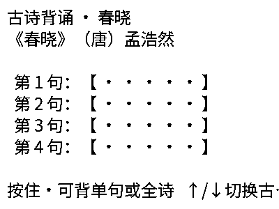</td></tr>
<tr><td align="center"><strong>口算闯关</strong><br></td><td align="center"><strong>英语短文阅读</strong><br>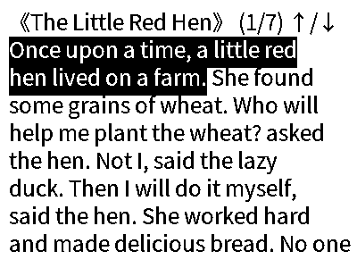</td></tr>
<tr><td align="center"><strong>番茄专注</strong><br></td><td align="center"><strong>屏保</strong><br>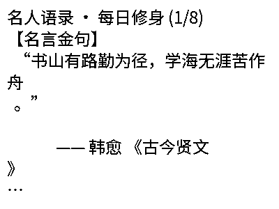</td></tr>
<tr><td align="center"><strong>诗词飞花令</strong><br>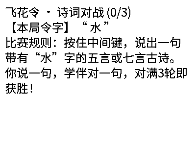</td><td align="center"><strong>猜猜看</strong><br>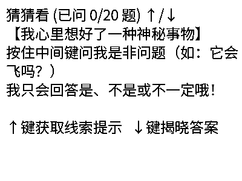</td></tr>
<tr><td align="center"><strong>事实核查</strong><br></td><td align="center"><strong>习惯打卡</strong><br></td></tr>
<tr><td align="center"><strong>每日课表</strong><br></td><td align="center"><strong>错字门诊</strong><br>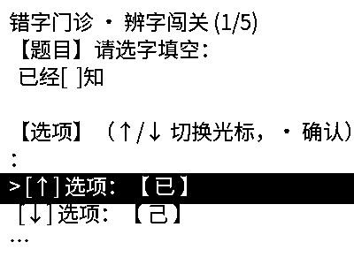</td></tr>
<tr><td align="center"><strong>英语生词</strong><br>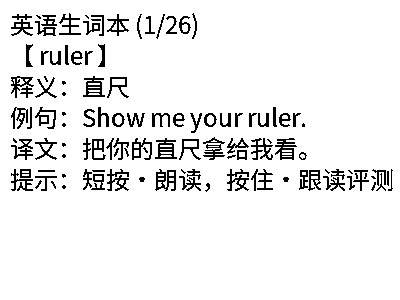</td><td align="center"><strong>费曼小老师</strong><br></td></tr>
<tr><td align="center"><strong>AI 学伴</strong><br>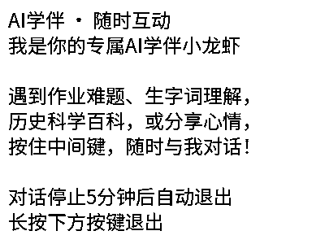</td><td align="center"><strong>功能导航菜单</strong><br>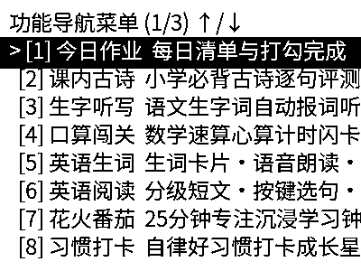</td></tr>
<tr><td align="center"><strong>小学新鲜事</strong><br></td><td align="center"><strong>每日成语</strong><br>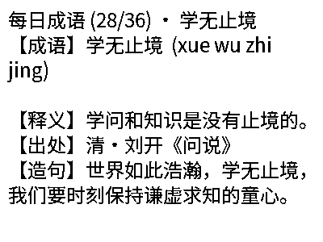</td></tr>
</table>

### 家长端与小程序页面

以下截图分别来自家长浏览器端和微信开发者工具中的小程序，使用独立的示例数据。

| 家长浏览器端 | 微信小程序端 |
| :---: | :---: |
| 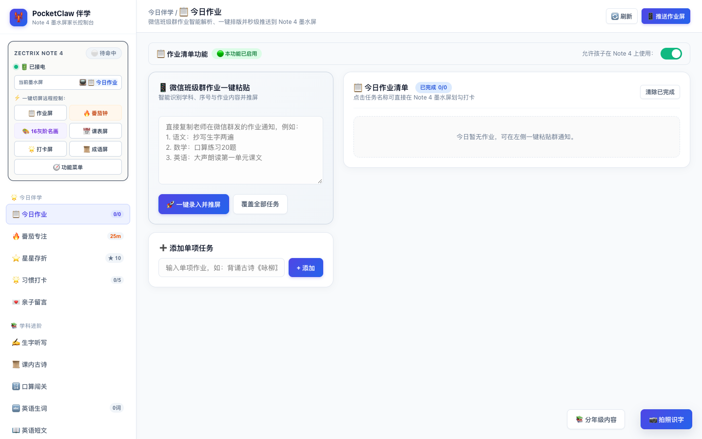 | 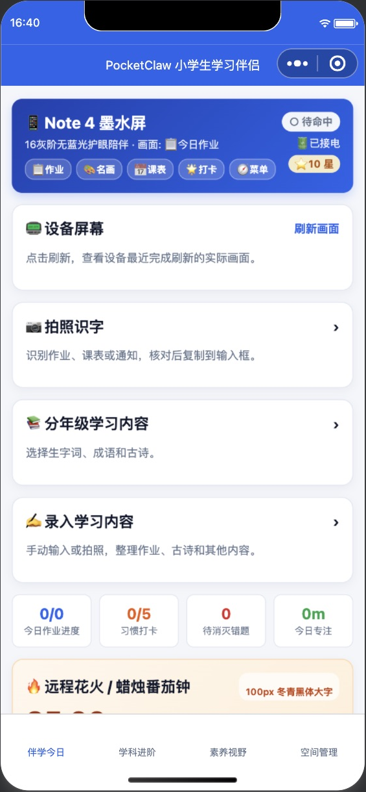 |

---

## 四、 学伴人设与 AI / OCR 双模式引擎

为了满足不同网络环境与个性化教育需求，PocketClaw 实现了**学伴人设深度自定义**与 **AI / OCR 本地/在线双模式热切换**：

### 1. 🦞 学伴人设自定义（Persona Customization）
- **动态身份与称谓**：默认为温暖活泼的卡通伙伴**“小龙虾”**，家长可在 Web 后台（Tab 17）或微信小程序随时修改为孩子喜爱的角色（如“智多星”、“小鹿老师”等）；
- **动态性格与语气**：支持自由配置学伴语气风格（“温和鼓励”、“生动活泼”、“严谨启发”等）；
- **专属苏格拉底 Prompt**：内置针对儿童的启发式引导词模板，严禁直接报答案，以提问引出思路；
- **Note 4 端动态渲染**：Note 4 屏幕对话泡泡与语音前缀动态跟随学伴名称刷新（呈现为 `{学伴名}说：...`）。

### 2. 🤖 LLM 本地 / 在线双模式引擎
- 🖥️ **本地离线版本 (Local)**：
  - 无需任何外部网络连接与 API Key；
  - 内置少儿动植物常识规则库、口算心算验证引擎与飞花令词库，杜绝网络波动；
  - 亦支持局域网私有部署的 Ollama / vLLM 模型接入。
- ☁️ **在线大模型直连 (Online)**：
  - 兼容标准 OpenAI 协议，内置主流大模型预设：**DeepSeek**、**通义千问 (Qwen)**、**火山方舟 (Doubao)**、**智谱 (GLM)**、**OpenAI (GPT-4o)**；
  - 支持家长端一键填入 `API Key`、`Base URL` 与 `Model Name`；
  - 支持界面**一键连通性测试 (Test Connection)** 与热重载，无需重启服务。

### 3. 📷 OCR 视觉本地 / 在线双模式引擎
- 🖥️ **本地正则解析模式**：基于结构化拼音与生字分词算法提取文本；
- ☁️ **在线多模态视觉模型**：调用商业大模型 Vision 接口，手机直接拍摄语文教材课后生字表或课外英语绘本，自动高精度提取生字生词、拼音音标、组词造句与双语短文。

---

## 五、 硬件驱动与墨水屏视觉系统

Note 4 搭载了 SSD2683 驱动的 4.2 英寸电子墨水屏（400×300 像素）。为了彻底解决墨水屏常见的残影、噪点与字体毛刺问题，项目实现了完整的硬件多波形直驱体系：

### 1. 16 灰阶（4bpp）硬件多阶段波形直驱
- **原厂多波形接入**：引入 `ssd2683_waveform.h` 外部 LUT 波形配置，每个灰阶包含 4 passes（每 pass 535 字节），直接向控制器 RAM 注入硬件级电泳微胶囊驱动脉冲；
- **全屏无噪点位图**：每帧采用 400×300 4bpp（60,000 字节，每字节打包两个像素高低半字节）结构，真实展现世界名画光影层次，杜绝 Floyd-Steinberg 误差扩散算法产生的粗糙颗粒。

### 2. 局刷/全刷双级抗残影架构
- **局刷时序**：在局刷前注入 OTP LUT 激活序列（`0x50 0x77`、`0xE0 0x00`、`0xA5` + `0x83`）；
- **全刷双级清底驱动（Double Base Clear）**：切换到重要页面执行全刷时，先施加一遍纯白底清屏脉冲消除直流极化，再复位写入新帧，使得白色背景获得双倍白向驱动力，跨页条纹残留率降为零。

### 3. 冬青黑体（Hiragino Sans GB）中英文混排视觉体系
- **汉字字模**：提取冬青黑体 W3（Hiragino Sans GB）高保真字形，涵盖部编版教材与日常应用全部 3,716 个高频汉字与生僻字；
- **西文字模**：混排适配 Montserrat SemiBold 比例宽度西文字符，基线对齐，数字与拉丁字母呈现手帐般设计感；
- **100px 番茄钟大字字模**：定制生成 `focus_digits.h`，超大数字边缘平滑饱满，十米外依然清晰可见。

---

## 六、 家长端与微信小程序

PocketClaw 提供 Note 4 设备、家长 Web 页面和微信小程序，家长可在浏览器或手机上管理孩子的学习内容与设备。

### 微信小程序

使用微信开发者工具导入 `miniprogram/`。底部导航包括伴学今日、学科进阶、素养视野和空间管理；相关页面提供作业、课表、练习内容、设备视窗和家庭设置。拍照识别需要配置可用的视觉模型，识别结果应由家长检查后再保存。

### 家长 Web 页面

启动服务后，在本机浏览器访问 `http://127.0.0.1:8000/pocketclaw/parent`；同一局域网的其他设备可使用服务所在电脑的局域网地址。页面提供学习内容录入、课表、设备控制、学伴设置及家庭账号管理。

---

## 七、 Note 4 机身交互与语音指令速查

### 1. 物理按键功能速查（三键盲操体系）

> [!IMPORTANT]
> **按键交互核心准则**：
> - **长按下方按键 `▼`**：退出当前界面 / 返回各自主页或退出至功能导航菜单；
> - **长按中间键（语音键 `●`）**：**呼叫 AI 学伴并开启流式语音提问**（杜绝了长按下键误跳学伴的体验问题）。

| 按键动作 | 今日作业清单 | 生字听写 | 诗词飞花令 | 英语分级阅读 | 📰 小学新鲜事 | 番茄专注钟 | 功能导航菜单 |
| :---: | :---: | :---: | :---: | :---: | :---: | :---: | :---: |
| **`▲` 键短按** | 光标上移一行 | 上一个词 | 获得诗句提示 | 光标上移选句(静默) | 上移选择上一篇报道 | 切换花火/蜡烛外观 | 光标上移选择 |
| **`▼` 键短按** | 光标下移一行 | 步进到下一个词 | **轮换新令字开局** | 光标下移选句(静默) | 下移选择下一篇报道 | 切换花火/蜡烛外观 | 光标下移选择 |
| **`●` 键短按** | 勾选/取消完成作业 | 重新朗读当前词 | 朗读当前令字规则 | **英音朗读当前句+显示中文** | **查看详细报道 / 语音朗读** | 暂停 / 继续倒计时 | **确认进入当前功能** |
| **`▼` 键长按** | 返回主菜单 | 返回主菜单 | 返回主菜单 | 切换下一篇短文 | **返回「小学新鲜事」主列表** | 提前结束当前专注 | 退出返回上一模式 |
| **`●` 键长按** | **呼叫 AI 学伴提问** | **呼叫 AI 学伴提问** | **流式语音对出诗句** | **录音跟读评测口语打分** | **呼叫 AI 学伴提问** | **呼叫 AI 学伴提问** | **呼叫 AI 学伴提问** |

### 2. 全局语音切换指令表（任何状态下均可语音直达）

| 意图目标 | 支持语音指令（按住 ● 说话后松开） |
| :--- | :--- |
| **进入作业清单** | “看作业”、“今天作业”、“作业清单”、“我的作业” |
| **开始生字听写** | “开始听写”、“听写生字”、“听写”、“生词听写” |
| **浏览小学新鲜事** | “小学新鲜事”、“新鲜事”、“看新闻”、“校园新闻”、“比赛展会”、“学习活动”、“有什么比赛” |
| **开始口算闯关** | “口算”、“做口算”、“口算大闯关”、“数学口算” |
| **开始古诗背诵** | “背古诗”、“背诵静夜思”、“背诵春晓”、“古诗质检” |
| **进入英语阅读** | “英语阅读”、“读短文”、“读课文”、“读第一篇”、“The Little Red Hen” |
| **进入英语生词** | “生词本”、“背单词”、“英语单词卡” |
| **启动番茄专注** | “番茄钟”、“开始专注”、“专注25分钟”、“专注” |
| **启动飞花令** | “飞花令”、“诗词对战”、“诗词飞花令” |
| **启动事实核查** | “核实一下”、“贝壳是动物吗”、“蘑菇是植物吗”、“8乘以9等于72吗” |
| **切换伴学屏保** | “换屏保”、“名画屏保”、“看画”、“星空”、“戴珍珠耳环的少女” |
| **每日成语学习** | “每日成语”、“成语卡”、“成语” |
| **打开功能菜单** | “功能菜单”、“菜单”、“返回主菜单” |

---

## 八、 快速启动与全链路部署指南

### 1. 固件工程编译与烧录 (`zectrix/`)

#### 依赖环境
- macOS / Linux
- [ESP-IDF v5.3 或更高版本](https://docs.espressif.com/projects/esp-idf/zh_CN/latest/esp32s3/get-started/)
- Python 3.10+

```bash
# 1. 激活 ESP-IDF 编译工具链
source ~/esp/esp-idf/export.sh

# 2. 进入固件目录并进行项目配置 (可选)
cd zectrix
idf.py set-target esp32s3

# 3. 编译整机固件
idf.py build

# 4. 连接 Note 4 USB 口，烧录固件并开启串口监视
idf.py -p /dev/cu.usbmodem11201 flash monitor
```

---

### 2. 独立伴学服务端启动 (`server/`)

#### 依赖环境
- Python 3.10 / 3.11 / 3.12
- 核心依赖：`fastapi`, `uvicorn`, `websockets`, `pydantic`, `httpx`, `pytest`

```bash
cd server

# 1. 创建并激活 Python 虚拟环境
python3 -m venv .venv
source .venv/bin/activate

# 2. 安装必要运行依赖
pip install -r requirements.txt

# 3. (可选) 配置在线大模型 API（未配置时默认启用内置离线规则库）
cp .env.example .env
# 编辑 .env 填入您的 API Key（支持 DeepSeek / 通义千问 / 豆包 / OpenAI 等）

# 4. 启动 PocketClaw 伴学服务端
python serve.py
```

#### Windows 安装与启动（PowerShell）

先安装 Python 3.10、3.11 或 3.12，并确认 `py --version` 可以运行。在 PowerShell 中进入本项目的 `server` 目录：

```powershell
cd "C:\你的项目路径\Zectrix-claw\server"
py -3.12 -m venv .venv
.\.venv\Scripts\python.exe -m pip install --upgrade pip
.\.venv\Scripts\python.exe -m pip install -r requirements.txt
Copy-Item .env.example .env
notepad .env
.\.venv\Scripts\python.exe serve.py
```

如安装的是其他受支持版本，请把 `py -3.12` 换成相应版本。直接使用虚拟环境的 Python，无需修改 PowerShell 脚本执行策略。使用 `requirements.txt` 安装：仓库内的 `requirements-lock.txt` 包含 macOS/Linux 专用的 `uvloop`，不能直接用于 Windows。

启动服务后，程序会等待服务就绪并自动在本机默认浏览器打开家长页面；如未自动打开，可手动访问 `http://127.0.0.1:8000/pocketclaw/parent`。其他设备连接时，在 Windows 上运行 `ipconfig`，使用同一局域网网卡的 IPv4 地址代替 `127.0.0.1`；若系统防火墙提示访问，请按实际网络环境允许连接。如果端口已被占用，可先用 `netstat -ano | findstr :8000` 查看，再临时使用 `$env:PORT="8001"; .\.venv\Scripts\python.exe serve.py` 启动，并同步修改设备和小程序地址。

`.env` 与 `server/data/` 为本机配置和数据，不要提交到仓库。Windows 下可运行服务端，但本仓库的 USB 设备令牌工具目前依赖 POSIX 串口接口、部分测试依赖 `pty`；它们需要 macOS/Linux 或 WSL，尚未在原生 Windows 真机上验证。

本仓库可独立运行，不需要同步或导入 `studyclaw`。依赖安装在 `server/.venv`，运行数据默认保存在被 Git 忽略的 `server/data/`，本地密钥保存在被忽略的 `server/.env`。使用 `uv` 时可执行：

```bash
cd server
uv venv --python 3.12 .venv
uv pip install --python .venv/bin/python -r requirements-lock.txt
.venv/bin/python serve.py
```

首次部署可从 `.env.example` 创建 `.env` 并自行填写凭据，切勿提交 `.env`。配置 OpenAI 兼容视觉模型后才能使用真实图片识别；视觉服务失败时不会返回示例结果。当前默认仍为家庭局域网模式，不提供完整的多租户认证。

如果启动时提示端口已被占用，先用 `lsof -nP -iTCP:8000 -sTCP:LISTEN` 确认占用者。需要与旧服务同时运行时，可用 `PORT=8001 .venv/bin/python serve.py` 启动独立服务，并把设备和小程序地址中的端口改为 8001；也可在确认旧服务不再使用后停止旧服务，再使用 8000。启动器优先识别真实局域网地址；如自动识别不符合设备所在网络，可在本地 `.env` 设置 `LAN_IP`。

服务就绪后会自动打开本机默认浏览器的家长端页面；无法自动打开时可访问 `http://127.0.0.1:8000/pocketclaw/parent`（端口按实际设置调整）。无桌面环境或不需要自动打开时，可在 `server/.env` 设置 `OPEN_BROWSER=0`。

**设备屏幕采集：**需要含 `screen_capture` 能力的新固件。小程序“空间管理”中设置 `server/.env` 内的 `POCKETCLAW_ADMIN_TOKEN`，首页点击“刷新画面”后设备返回已完成刷新的帧缓冲。设备忙、离线或固件过旧时会明确提示，画面按需采集而非连续直播。令牌只应在可信设备上使用；跨网络部署需通过 HTTPS/WSS 保护传输。

**家庭隔离模式：**在本机使用 `.venv/bin/python identity_admin.py create-family 家庭名 孩子名` 创建家庭，然后在本地 `.env` 中设置 `POCKETCLAW_MULTI_TENANT=required`。该模式将每个家庭的数据、设备会话和模型运行实例分开，并要求 HTTPS/WSS；反向代理必须由可信地址连接服务，必要时设置 `FORWARDED_ALLOW_IPS`。小程序在“空间管理”登录并可为设备签发或撤销令牌；模型配置由服务管理员管理。多租户模式下 `/pocketclaw/parent` 提供家庭登录、孩子资料、设备页面和功能开关、口算设置、练习选择与听写批改、周课表、学习内容录入、分年级预设内容、专注与奖励、屏保、学伴设置及设备凭据管理。家庭隔离模式面向单进程部署；启用时需要单独配置家庭和设备。

**设备凭据配置：**家庭管理页签发凭据后，通过可信的物理串口使用 `python provision_device.py --port 串口路径 --device-id 设备WiFiMAC`，工具会无回显地提示输入凭据，并在写入前核对设备报告的 MAC。固件必须临时启用 `CONFIG_POCKETCLAW_USB_PROVISION`，启动后开放 60 秒配置窗口；完成后换回关闭该选项的正常固件。默认构建的控制台输入为 UART0，具体 USB 转串口连接要按设备实际线路确认。该流程不会修改分区表，但固件烧录及串口配置尚未在 Note 4 真机上验证；不要在未备份、未确认固件及分区兼容性时烧录。NVS 是否加密取决于设备安全配置，物理接触设备的人员仍可能读取凭据，丢失设备时应撤销令牌。

**语音交互：**实时语音识别通过 `POCKETCLAW_VOLC_ASR_STREAMING=1` 启用，失败时回退到整段识别；中间识别结果仅在学伴页面显示。兼容流式接口的语言模型按句启动语音合成，无流式结果时回退到普通回答。代码中保留的唤醒实验选项默认关闭，未经过真机验证，不属于当前交付功能。

**孩子资料：**在小程序“空间管理”或家长 Web 的“学伴与AI设置”中填写名字、年级、性别和兴趣爱好；多家庭 Web 登录后也可设置。信息可以留空或清除，按孩子分别保存。AI 学伴每轮对话会读取当前孩子的资料，参考年级调整解释难度，并在适合时使用名字和兴趣；不会依据性别推测能力或喜好。使用在线模型时，所填资料会随对话发送给所配置的模型服务。离线规则库的个性化能力有限。

**周课表与录入：**家长 Web 和小程序课表编辑页按周一至周五展示六节课与每日备忘，可一次编辑并保存整周。默认课表和示例活动仅供体验，不代表实际课程或经过核实的活动信息。通用“拍照识字”会先展示可编辑结果；浏览器可填入选中的文本框，小程序可复制后粘贴，均需家长核对并手动保存。所选照片会发送至配置的视觉模型服务。

**分年级内容：**家长端“分年级内容”支持按建议年级筛选生字词、成语和古诗，勾选、全选或不选。年级分组按难度建议，不代表特定教材的编排。导入生字词会创建并启用一份新听写词单；诗词、成语加入自定义内容，遇到同名自定义内容会跳过，不覆盖。

> **服务启动说明**：
> - 默认监听端口：`0.0.0.0:8000`（自动输出局域网 IP）
> - **Note 4 硬件 WebSocket**：`ws://<服务器IP>:8000/pocketclaw`
> - **家长端 Web 管理后台**：`http://<服务器IP>:8000/pocketclaw/parent`
> - **微信小程序 API 路由**：`http://<服务器IP>:8000/api/pocketclaw/*`
> - **系统健康自检接口**：`http://<服务器IP>:8000/health`

---

### 3. 微信小程序运行与真机预览 (`miniprogram/`)

1. 下载并安装 [微信开发者工具](https://developers.weixin.qq.com/miniprogram/dev/devtools/download.html)；
2. 启动微信开发者工具，选择 **“导入项目”**；
3. 选择目录 `Zectrix-claw/miniprogram`；
4. AppID 可选择您注册的小程序 AppID，或在测试阶段选择 **“测试号”**；
5. 在工具栏右上角打开 **“详情”** -> **“本地设置”**，勾选 **“不校验合法域名、web-view (业务域名)、TLS 版本以及 HTTPS 证书”**；
6. 模拟器打开后，在底部 **“学情成长”** Tab 中将主机地址设置为服务端当前 IP（例如 `http://192.168.1.xxx:8000`），即可点击工具栏 **“预览”** 扫码真机体验。

---

### 4. 家庭服务器 (Mac Mini) 与跨 Wi-Fi 远程移动伴学组网方案

当我们将伴学服务常驻架设在家中的 **Mac Mini（或各类家庭 Linux/NAS 服务器）** 上时，Note 4 墨水屏设备通常面临两种典型使用场景：
1. **书桌日常使用（同局域网 WiFi）**：Note 4 与 Mac Mini 处于同一路由器下；
2. **移动/课外使用（跨 WiFi / 远程使用）**：孩子带掌机去学校、图书馆、长辈家，或在车上连接家长手机 4G/5G 移动热点。

本项目针对上述场景提供了**“双端点智能无缝热备 + NAT 长效保活 + 零成本外网映射”**的完整解决方案：

#### ⚙️ 架构设计与工作机制

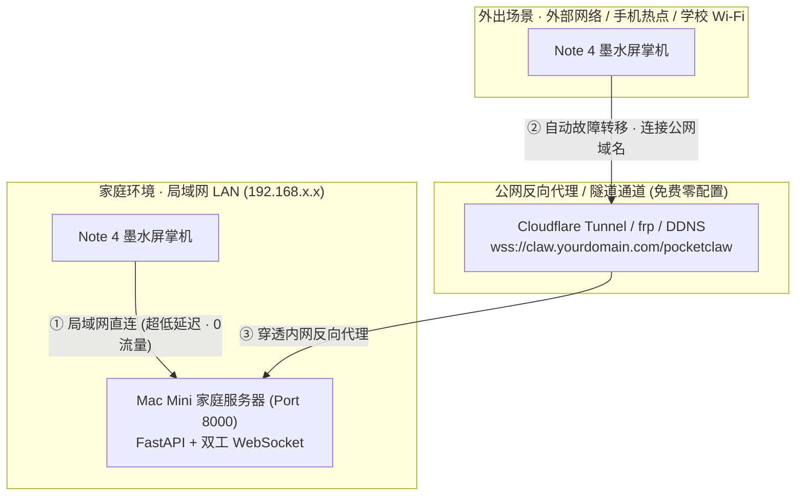

- **双端点智能故障转移 (Dual-Endpoint Auto-Failover)**：
  - Note 4 固件内部维护 `server_url_primary`（局域网主地址，如 `ws://macmini.local:8000/pocketclaw`）与 `server_url_backup`（远程公网备用地址，如 `wss://claw.yourdomain.com/pocketclaw`）；
  - 在家开机时，设备优先秒连局域网主地址（0 外网流量消耗、局域网微秒级响应）；
  - 一旦离开家庭 WiFi，连接主地址失败后**固件自动无感轮转切换至远程备用地址**，绝不反复死机重启；
  - 放学回到家中时，若网络重连优先切回内网主地址。
- **20 秒 NAT 活跃心跳 (Keep-Alive)**：
  - 移动热点与公共 WiFi 常常在 30~60 秒无数据后强制切断 NAT 映射。Note 4 固件每 20 秒主动向 Mac Mini 发送心跳帧与实时电量，并触发 WebSocket Ping，彻底杜绝半开连接与假死。
- **手机热点可视化 AP 配网**：
  - 掌机进入配网模式后，手机连接 Note 4 热点打开配网页面（`http://192.168.4.1/`），在“高级选项”中可直接可视化查看和修改“主服务地址”与“远程备用地址”，一键持久化至 ESP32 NVS 存储。

#### 🌐 Mac Mini 外网映射配置指南 (4 种零成本方案任选其一)

##### 方案 A（强烈推荐）：Cloudflare Tunnel（完全免费 · 免公网IP · 自动自带 HTTPS/WSS 证书）
1. 在 Mac Mini 上安装 Cloudflared 客户端：
   ```bash
   brew install cloudflared
   ```
2. 启动快速免费隧道（免注册即开即用）：
   ```bash
   cloudflared tunnel --url http://localhost:8000
   ```
3. 控制台会输出专属公网地址（例如 `https://quick-rabbit-xxxx.trycloudflare.com`）；
4. 将该地址对应的 WebSocket 填入 Note 4 的备用地址：
   `wss://quick-rabbit-xxxx.trycloudflare.com/pocketclaw`；
5. 在微信小程序与手机浏览器中，亦可直接使用该 HTTPS 地址跨网管理作业！

##### 方案 B：frp / cpolar 内网穿透
- 若已有云服务器，在 Mac Mini 上运行 `frpc` 将本地 `8000` 端口映射至云主机的公共端口，Note 4 填入 `ws://your-vps-ip:port/pocketclaw`。

##### 方案 C：Tailscale Funnel
- 在 Mac Mini 上运行 `tailscale funnel 8000`，直接获得一条受保护的公共安全入口。

##### 方案 D：家庭路由器 DDNS + 端口转发
- 若家庭宽带有公网 IPv4 或 IPv6，在路由器后台将外网端口（如 `8000`）映射到 Mac Mini 的内网静态 IP，并绑定 DDNS 域名。

---

## 九、 自动化测试与工程质量保障

项目配备了完善的自动化测试套件，全面覆盖状态机路由、墨水屏防剧透逻辑、16 灰阶渲染管线、按键消抖时序、REST API 行为与学伴/AI 配置热重载。

在 `server/` 目录下执行独立服务的单元与集成测试：

```bash
cd server
pytest -v
```

模拟设备和 HTTPS/WSS 测试不能代替 Note 4 和微信小程序真机验证。

运行伴学功能模拟交互检查：

```bash
cd server
python pocketclaw/tools/verify_all_features.py
```

---

## 十、 开源协议与致谢

### 📄 开源许可证 (License)

本项目采用 **[MIT License](LICENSE)** 开源许可证发布。

- **自由使用**：允许个人、学校、开发者及商业机构免费使用本仓库的固件、服务端及小程序源码；
- **允许修改与分发**：允许自由修改代码、派生新功能并在保留原作者版权声明的前提下重新发布；
- **免责声明**：软件按“现状”（AS IS）提供，不包含任何明示或暗示的担保。

### 💖 硬件平台与致谢

- **硬件平台**：[ZECTRIX Note 4](https://www.zectrix.com) 墨水屏全天候便携硬件
- **驱动芯片**：Solomon Systech SSD2683 E-Paper Display Controller (16灰阶点对点驱动)
- **字体支持**：Hiragino Sans GB (冬青黑体) & Montserrat SemiBold
- **核心框架**：Espressif ESP-IDF v5.3 & FastAPI & WebSockets

---

## 十一、 开源教育资源引用与致谢 (Open Source Educational Resources)

为丰富 Note 4 硬件伴学机在**小学 1~6 年级全学段、多学科（语文、数学、英语、科学与通识常识）**的功能内容，本项目引用并深度整合了以下权威开源教育数据集与算法库。在此向所有开源项目的作者与贡献者表达由衷的敬意与谢意：

| 学科领域 | 开源资源 / 仓库链接 | 许可协议 | 引用年级段 | 在 Note 4 伴学系统中的具体赋能应用点 |
| :--- | :--- | :---: | :---: | :--- |
| **语文 · 古诗文** | [**chinese-poetry/chinese-poetry**](https://github.com/chinese-poetry/chinese-poetry)<br>*(中华最全古诗词数据库)* | **MIT** | 1~6 年级 | 扩充部编版小学必背古诗词库（扩充至 42 首经典律诗绝句），按字逐句比对纠偏；赋能诗词飞花令 16 大令字正统对仗句库。 |
| **语文 · 成语典故** | [**crazywhalecc/idiom-database**](https://github.com/crazywhalecc/idiom-database)<br>& [**pwxcoo/chinese-xinhua**](https://github.com/pwxcoo/chinese-xinhua) | **MIT** | 2~6 年级 | 扩充小学生每日国学成语库（扩充至 36 条，涵盖勤学、寓言、哲理与品德典故），提供规范注音、通俗白话释义、出处与造句示例。 |
| **语文 · 汉字规范** | [**mozillazg/pinyin-data**](https://github.com/mozillazg/pinyin-data)<br>& [**chanind/hanzi-writer-data**](https://github.com/chanind/hanzi-writer-data) | **MIT** | 1~3 年级 | 提供生字词听写官的标准普通话拼音与规范汉字部首笔画间架结构映射，支撑听写拍照批改中的错字与不规范书写精准辨析。 |
| **英语 · 课标词汇** | [**RealKai42/qwerty-learner**](https://github.com/RealKai42/qwerty-learner)<br>*(PEP 小学英语课标词库)* | **MIT** | 3~6 年级 | 扩充英语生词本核心词库（覆盖 106 个高频课标词汇），涵盖学习用品、日常场所、时间天气、性格特征、四季月份与旅行探索，严格配备地道例句与中文释义。 |
| **英语 · 分级阅读** | [**Project Gutenberg**](https://www.gutenberg.org/)<br>*(公版经典少儿英语文学读物)* | **Public Domain** | 3~5 年级 | 扩充少儿双语经典分级阅读（新增《龟兔赛跑》、《狮子与老鼠》、《狼来了》、《乌鸦喝水》、《蚂蚁与蚱蜢》），句式规范、生动有趣，支持逐句选句与口语评分。 |
| **数学 · 分级口算** | [**fanfannnmn/HomeworkMaker**](https://github.com/fanfannnmn/HomeworkMaker)<br>& [**Cokedog320/mathtext**](https://github.com/Cokedog320/mathtext) | **Apache 2.0 / MIT** | 1~6 年级 | 口算分级题型：1年级20以内进退位加减、2年级100以内与表内乘除、3~4年级多位数与两步混合运算、5~6年级乘法分配律简算与百千速算。 |
| **科学 · 事实核查** | [**xiaoyang111222/cn-math-taxonomy**](https://github.com/xiaoyang111222/cn-math-taxonomy)<br>& 公版少儿百科科学分类 | **MIT / CC0** | 1~6 年级 | 扩充拆拆看推理知识库（36条天文、昆虫、动植物、仪器）与少儿事实核查库（32条声学、光学、人体与自然现象真伪辨析）。 |
